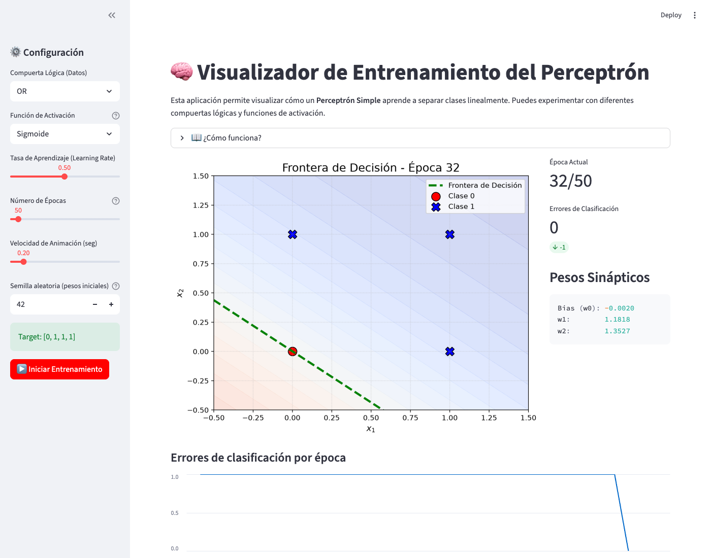

# 🧠 Entrenamiento del Perceptrón

[](https://entrenamientoperceptron-howpmjddzjx9xby7bjeqoi.streamlit.app)
[](https://github.com/Andresnico172/Entrenamiento_perceptron/actions/workflows/ci.yml)


### ▶ **[Abrir la app](https://entrenamientoperceptron-howpmjddzjx9xby7bjeqoi.streamlit.app)**: funciona en el navegador, sin instalar nada.

App interactiva que muestra, época a época, cómo un **perceptrón simple** aprende a separar dos clases con una recta.
Se entrena sobre las compuertas lógicas **AND, OR, NAND y XOR**, con función de activación **escalón** o **sigmoide**.
En el caso de XOR se ve por qué un perceptrón sin capa oculta no puede resolverlo.

[](https://entrenamientoperceptron-howpmjddzjx9xby7bjeqoi.streamlit.app)

## Qué se puede hacer en la app

| Control | Para qué sirve |
|---|---|
| **Compuerta lógica** | Elige los datos: OR, AND, NAND (linealmente separables) o XOR (no separable). |
| **Función de activación** | Escalón (regla de Rosenblatt) o sigmoide (descenso de gradiente). |
| **Tasa de aprendizaje** | Tamaño del paso en cada actualización de los pesos. |
| **Número de épocas** | Máximo de pasadas por los datos. El entrenamiento se detiene antes si llega a 0 errores. |
| **Velocidad de animación** | Pausa entre épocas, para seguir el movimiento de la frontera. |
| **Semilla aleatoria** | Fija los pesos iniciales: con la misma semilla el resultado es reproducible. |

Durante el entrenamiento se muestran la **frontera de decisión**, la región que el modelo asigna a cada clase, los
**pesos** $w_0, w_1, w_2$, los **errores por época** y, al final, la **tabla de verdad** con la predicción de cada
entrada.

## El modelo

El perceptrón calcula una combinación lineal de las dos entradas más un sesgo (bias) y aplica una función de activación:

$$z = w_0 + w_1 x_1 + w_2 x_2, \qquad \hat y = f(z)$$

Los pesos se inicializan al azar en $[-0.5, 0.5]$ y se actualizan muestra a muestra:

| Activación | $f(z)$ | Regla de actualización |
|---|---|---|
| **Escalón** | $1$ si $z \ge 0$, $0$ si no | Rosenblatt: $w \leftarrow w + \eta\,(y - \hat y)\,x$ |
| **Sigmoide** | $\dfrac{1}{1 + e^{-z}}$ | Regla delta (gradiente del error cuadrático): $w \leftarrow w + \eta\,(y - \hat y)\,\hat y\,(1 - \hat y)\,x$ |

donde $x = (1, x_1, x_2)$ incluye el 1 del bias y $\eta$ es la tasa de aprendizaje. Con la sigmoide, la clase
predicha es 1 si $\hat y \ge 0.5$, lo que equivale a $z \ge 0$. Por eso la **frontera de decisión** es siempre la recta
$w_0 + w_1 x_1 + w_2 x_2 = 0$.

**Por qué XOR no converge.** El teorema de convergencia del perceptrón garantiza que, si los datos son linealmente
separables (AND, OR, NAND), la regla de Rosenblatt encuentra una recta que los separa en un número finito de pasos.
En XOR, los puntos (0,1) y (1,0) son de clase 1, y (0,0) y (1,1) de clase 0: ninguna recta los separa, así que siempre
queda al menos un punto mal clasificado. Resolverlo requiere una red con capa oculta (perceptrón multicapa).

## Ejecutar en local

```bash
python -m venv .venv && source .venv/bin/activate
pip install -r requirements.txt
streamlit run entrenamiento.py      # abre http://localhost:8501
```

Tests y linter:

```bash
pip install pytest ruff
pytest -q                           # 11 tests, ~6 s
ruff check --line-length 120 .
```

Los tests comprueban que el perceptrón converge en AND, OR y NAND con ambas activaciones, que nunca converge en XOR,
que la semilla hace el entrenamiento reproducible y que la app arranca y entrena sin errores (`streamlit.testing`).
Se ejecutan en cada push con GitHub Actions.

También se puede abrir en **GitHub Codespaces**: el `.devcontainer` instala las dependencias y lanza la app sola.

## Estructura

```
├── entrenamiento.py         app de Streamlit (interfaz, gráficos y animación)
├── perceptron.py            modelo: clase Perceptron y datos de las compuertas lógicas
├── test_perceptron.py       tests del modelo y smoke test de la app
├── requirements.txt
├── docs/app.png             captura para este README
├── .devcontainer/           configuración para Codespaces
└── .github/workflows/ci.yml tests y linter en cada push
```
